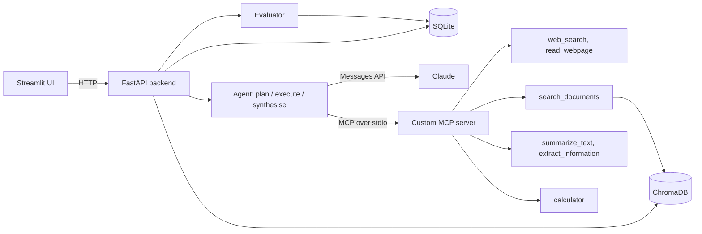

# AI Research Agent with MCP Integration

An AI research assistant that turns a natural-language question into a **cited, structured report**. A Claude-powered agent plans the work, picks tools through a **custom MCP server**, searches the web and your uploaded PDF/TXT documents (ChromaDB RAG), and every report is **automatically evaluated** for relevance, factual consistency, citation validity, completeness and hallucination indicators.

**Stack:** Python · Claude API · MCP Python SDK · FastAPI · Streamlit · SQLite · ChromaDB · Pandas · Pytest

## Features

| Area | What it does |
|---|---|
| Agent | Plans 1-5 tasks, lets Claude choose tools per task, forces a final answer after `MAX_TOOL_ROUNDS`, synthesises a report |
| MCP server | `web_search`, `read_webpage`, `search_documents`, `summarize_text`, `calculator`, `extract_information` (stdio) |
| Documents | PDF/TXT upload, text extraction, overlapping chunking, embeddings, semantic retrieval |
| Citations | Sources get `[S#]` labels; the report's reference list links web URLs or document passages |
| Evaluation | Five metrics: LLM judge + programmatic checks, stored per run |
| UI | Dashboard, chat, research with live agent trace, documents, history, reports (MD + PDF), evaluation |

## Architecture



More diagrams and design notes: [docs/architecture.md](docs/architecture.md).

## Project structure

```
ai-research-agent/
├── app/                    # Streamlit UI + HTTP client
├── src/research_agent/
│   ├── agent/              # agent loop, prompts, MCP client, source registry
│   ├── mcp_server/         # custom MCP server (FastMCP, stdio)
│   ├── tools/              # calculator, web search/reader, LLM tools
│   ├── documents/          # extraction, chunking, ChromaDB store
│   ├── evals/              # evaluator + benchmark runner
│   ├── reports/            # Markdown + PDF generation
│   ├── api/                # FastAPI app
│   ├── db.py  llm.py  config.py  citations.py
├── tests/                  # pytest suite
├── data/sample/            # sample TXT + PDF documents
├── evals/dataset.jsonl     # regression questions
├── docs/  screenshots/  scripts/
```

## Installation

Requires Python 3.10+ (3.11+ recommended).

```bash
git clone https://github.com/<your-username>/ai-research-agent.git
cd ai-research-agent
python -m venv .venv

# macOS / Linux
source .venv/bin/activate
cp .env.example .env
# Windows PowerShell
# .venv\Scripts\Activate.ps1
# copy .env.example .env

pip install -r requirements.txt
```

Edit `.env` and set `ANTHROPIC_API_KEY` (create one at https://console.anthropic.com/). `.env` is git-ignored. The first document upload downloads Chroma's small ONNX embedding model (~80 MB), so it needs internet once.

## Running

Use two terminals (venv activated in both):

```bash
# 1) backend (API docs at http://127.0.0.1:8000/docs)
python -m research_agent.api

# 2) frontend
streamlit run app/streamlit_app.py
```

Then open http://localhost:8501, go to **Documents → Load sample documents**, and try a question on **Research** or **Chat**, for example: *"What are the three primitives of MCP and who controls each?"* or *"A model costs $3 per million input tokens and $15 per million output; what does 12,000 input and 2,500 output tokens cost?"*

> Windows: do not start the API with `--reload`. The MCP client spawns a subprocess, which needs the default event loop that reload mode replaces.

### Using the MCP server on its own

```bash
python -m research_agent.mcp_server.server                     # stdio server
npx @modelcontextprotocol/inspector python -m research_agent.mcp_server.server
```

Claude Desktop config example:

```json
{
  "mcpServers": {
    "research-agent": {
      "command": "/abs/path/ai-research-agent/.venv/bin/python",
      "args": ["-m", "research_agent.mcp_server.server"],
      "env": {
        "PYTHONPATH": "/abs/path/ai-research-agent/src",
        "ANTHROPIC_API_KEY": "your-key"
      }
    }
  }
}
```

## Testing

```bash
pytest
```

Tests need no API key or network: LLM and tools are replaced by scripted test doubles. The MCP integration test starts the real server over stdio; the vector-store test uses a deterministic embedding function.

Evaluation benchmark against the real model (needs API key and internet):

```bash
python -m research_agent.evals.benchmark --ingest-samples --limit 3
```

## Evaluation methodology

Scores are 0-1, higher is better.

| Metric | How it is computed |
|---|---|
| Answer relevance | 70% LLM judge + 30% key-term coverage of the question |
| Factual consistency | LLM judge against the evidence the agent retrieved (heuristic sentence-support fallback) |
| Citation validity | Programmatic: `[S#]` markers resolve, factual sentences are cited, URLs well-formed |
| Response completeness | 70% LLM judge + 30% structure/coverage heuristic |
| Hallucination indicators | Programmatic (numbers/URLs/sentences absent from evidence, absolute wording) blended 50/50 with the judge's risk rating |

If the judge call fails, the heuristic part is used and the result is flagged. These are indicators for human review, not proof of correctness. Judge scores can vary slightly between runs.

## REST API

| Method | Path | Purpose |
|---|---|---|
| GET | `/health`, `/stats`, `/tools` | status, dashboard numbers, MCP tool list |
| POST/GET/DELETE | `/documents` | upload, list, delete |
| POST | `/research` | start a run (returns `run_id`) |
| GET | `/runs`, `/runs/{id}` | history, live trace, report, evaluation |
| GET | `/runs/{id}/report?format=md\|pdf` | export |
| POST | `/runs/{id}/evaluate` | (re-)evaluate |
| POST/GET | `/chat`, `/chat/{session_id}` | conversational runs with history |

## Upload to GitHub

```bash
git init
git add .
git status            # confirm .env and storage/ are NOT listed
git commit -m "Initial commit: AI research agent with MCP"
git branch -M main
git remote add origin https://github.com/<your-username>/ai-research-agent.git
git push -u origin main
```

Create the empty repository on github.com first. Add screenshots to `screenshots/` (see its README), and replace "Your Name" in `LICENSE`.

## Known limitations

- Scanned/image-only PDFs are not supported (no OCR).
- Web search uses DuckDuckGo via the `ddgs` package: unofficial, can be rate-limited, snippets can be thin. `read_webpage` does not run JavaScript and blocks private addresses (a DNS-rebinding race remains theoretical).
- One MCP server subprocess is started per run; the API process writes to Chroma while the MCP subprocess reads. Fine for a single-user demo; for multi-user use run Chroma in server mode (`CHROMA_HOST`) and the MCP server over HTTP.
- No authentication on the API; do not expose it publicly.
- PDF export uses built-in Latin fonts; characters outside Windows-1252 become `?`.
- LLM-judged scores are noisy and can share biases with the model that wrote the report.
- Runs are in-process background tasks, so they are lost if the server restarts (marked failed on next start).

## Future improvements

Streaming responses, OCR for scans, hybrid (BM25 + vector) retrieval with reranking, MCP over Streamable HTTP, authentication and per-user workspaces, a larger labelled evaluation set with human-calibrated judge scores, and a proper job queue.

## License

MIT
