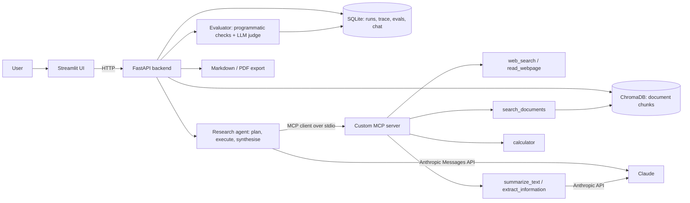

# Architecture

## Components



## Research run (sequence)

```mermaid
sequenceDiagram
    participant UI as Streamlit
    participant API as FastAPI
    participant AG as Agent
    participant C as Claude
    participant M as MCP server
    UI->>API: POST /research
    API-->>UI: 202 {run_id}
    API->>AG: background task (spawns MCP server)
    AG->>M: tools/list
    AG->>C: plan (forced submit_plan tool)
    loop each task, up to MAX_TOOL_ROUNDS
        AG->>C: task + tool schemas
        C-->>AG: tool_use
        AG->>M: tools/call
        M-->>AG: result (sources get [S#] labels)
    end
    AG->>C: synthesise report (forced submit_report tool)
    AG-->>API: report + sources + trace
    API->>API: evaluate and store
    UI->>API: GET /runs/{id} (polled; trace shown live)
```

## Design decisions

- **Forced tool calls for structured output** (plan, report, judge) avoid fragile JSON parsing.
- **Source registry**: every web result or document passage gets a stable `[S#]` label, so citations can be verified programmatically.
- **One MCP server process per run** (stdio). Simple and isolated; a long-lived HTTP server is the production alternative.
- **Evaluation is hybrid**: deterministic checks (citation resolution, unsupported numbers/URLs) plus an LLM judge scored against the evidence the agent actually retrieved.
